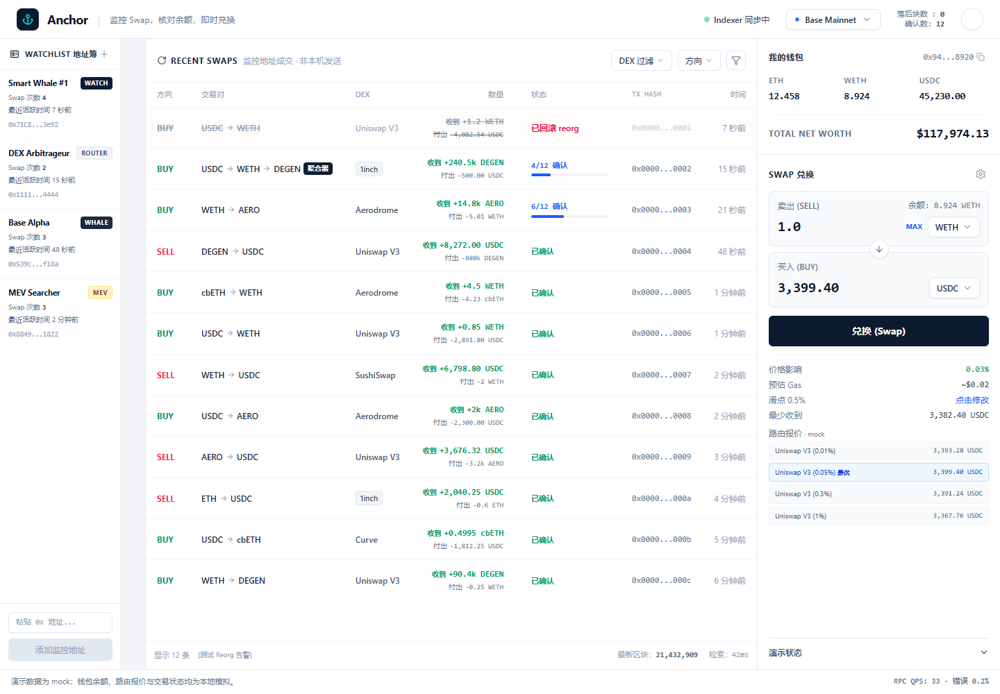

# Anchor

**Base DEX Swap Monitor** — 实时链上 Swap 监控 + 钱包地址追踪 + 余额对账 + 即时 DEX 报价兑换。

Anchor 面向链上交易者：把「关注地址在做什么、何时成交、成交价」实时呈现在一个界面，并支持模式 A（用户钱包签名）询价兑换。

> 当前状态：Java 后端（Indexer + API）与 Vite 前端 Live/Mock 双模式已可联调；扫块经 Transactional Outbox 投递 Kafka，状态栏与 RECENT SWAPS 可走真实数据。设计见 [`docs/backend-design.md`](docs/backend-design.md)。



## 核心能力

| 能力 | 说明 |
| --- | --- |
| Swap 实时流 | 扫块解析 Watchlist 地址的 DEX Swap，经 Outbox → Kafka → WS 推送 |
| 地址监控 | Watchlist（WATCH / ROUTER / MEV / WHALE / KOL），按 `tx.from` 过滤 |
| 确认状态机 | `CONFIRMING → CONFIRMED → FINALIZED`，处理 reorg |
| 余额对账 | 钱包持仓与链上余额对比 |
| 即时兑换 | Uniswap V3 报价 / prepare / 钱包签名 / report（P5a） |
| 状态栏 | 头块、已扫、落后、RPC QPS、Kafka lag / outbox 待推送 |
| 响应式 | 桌面三栏；移动端 Tab |

## 仓库结构

```
anchor/
├── backend-java/           # Java 21 Maven 多模块
│   ├── common/             # 实体、RPC、解析契约、MyBatis、配置
│   ├── indexer/            # 扫块、入库、OutboxRelay、Reorg
│   ├── api/                # REST + WebSocket + 报价/交易
│   └── parser/             # Swap 解析实现（被 indexer 引用）
├── db/migrations/          # Flyway SQL（含 V5 outbox_event）
├── contracts-shared/       # chains.yaml、Kafka/WS 契约
├── deploy/                 # docker-compose：PG / Redis / Redpanda / 监控
├── docs/                   # 设计与路线图
└── front_end/              # React 19 + Vite + wagmi
```

## 本地运行

### 基础设施

```bash
cd deploy
docker compose up -d
```

默认：Postgres `5432`、Redis、Redpanda 对外 `19092`。若本机 `localhost:19092` 被 WSL/代理劫持，在 `deploy/.env` 设置 `KAFKA_ADVERTISE_HOST=<本机 LAN IP>` 后重建 Redpanda，应用侧 `KAFKA_BOOTSTRAP` 指向同一地址。

### 后端

前置：JDK 21、Maven 3.8+。

```bash
cd backend-java
mvn -pl api,indexer -am package -DskipTests
# API（8080）与 Indexer（8081）分别启动；具体 main 类见各模块 bootstrap
```

常用配置：`anchor.kafka.enabled`、`anchor.scanner.max-catchup-blocks`（默认 2000）、`anchor.scanner.catchup-batch-size`（默认 50）。

### 前端

```bash
cd front_end
npm install
npm run dev    # http://localhost:3000，代理 /api 与 /ws
```

Live 模式连真实后端；Mock 模式用本地占位数据（见 `front_end` 内环境开关）。`GEMINI_API_KEY` 仅可选 AI 能力，**勿提交密钥**。

## 技术栈

**前端**：React 19 · TypeScript · Vite · Tailwind · wagmi  
**后端**：Java 21 · Spring Boot 3.3 · MyBatis-Plus · Flyway · Kafka(Redpanda) · Redis · PostgreSQL · Micrometer

## 设计文档

- [`docs/backend-design.md`](docs/backend-design.md) — 架构、Outbox、确认/reorg、可靠性
- [`docs/swap-trade-flow.md`](docs/swap-trade-flow.md) — P5a 询价兑换
- [`contracts-shared/kafka-topics.md`](contracts-shared/kafka-topics.md) — Kafka 契约
- [`contracts-shared/ws-messages.md`](contracts-shared/ws-messages.md) — WebSocket 契约
- [`docs/chains-yaml.md`](docs/chains-yaml.md) — 链配置
- [`docs/roadmap-tasks.md`](docs/roadmap-tasks.md) — 后续任务拆分
- [`docs/p5a-sepolia-checklist.md`](docs/p5a-sepolia-checklist.md) — Sepolia 联调清单

## Roadmap（摘要）

- [x] 前端 Mock 原型
- [x] Indexer 扫块 / Swap 解析 / checkpoint / reorg
- [x] Transactional Outbox + Kafka + API WS
- [x] 状态栏指标（含 outboxPending / kafkaStale）
- [x] P5a 用户钱包签名兑换（Sepolia）
- [ ] 压测与告警、限价单等（见 `docs/roadmap-tasks.md`）
