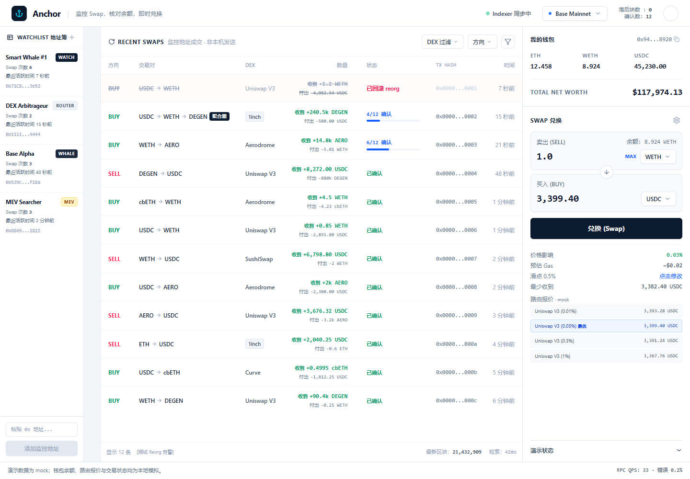
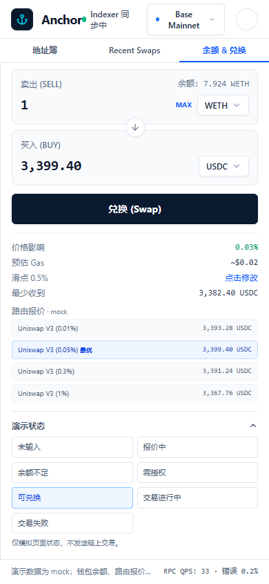

# Anchor

**Base DEX Swap & Mempool Monitor** — 实时链上 Swap 监控 + 钱包地址追踪 + 余额对账 + 即时 DEX 聚合报价。

Anchor 是一个面向链上交易者的 Web 应用：用户不需要盯着一堆区块浏览器标签页，而是把「关注的地址在做什么、什么时候成交、成交在什么价格」实时呈现在一个界面里。

> 当前状态：前端已完成可交互原型（Mock 数据驱动），后端技术方案已成型、待实现。详见 [`docs/backend-design.md`](docs/backend-design.md)。



## 核心能力

| 能力 | 说明 |
| --- | --- |
| Swap 实时流 | 按区块推送最近的 Swap 事件，带方向（BUY/SELL）、DEX 来源、金额与 Gas |
| 地址监控 | 维护 Watchlist（WATCH / ROUTER / MEV / WHALE / KOL 标签），只看关注对象的成交 |
| 确认状态机 | 展示 `confirming → finalized` 流程，并处理 reorg 回滚提示 |
| 余额对账 | 钱包持仓与链上余额对比，暴露差异而非"看起来对得上" |
| 即时兑换 | 代币对选择、聚合器路由（1inch / Uniswap V3 / Aerodrome / Curve / SushiSwap …）、成交步骤反馈 |
| 交易详情 | 单笔交易拆解：路由 hops、gas、区块号、收发地址 |
| 多链切换 | 配置驱动的网络注册表（Base / 其他 EVM 链 / Solana 适配策略） |
| 响应式 | 桌面三栏布局，移动端切换为 Tab 视图 |

<p align="center">
  
</p>

## 仓库结构

```
anchor/
├── docs/
│   └── backend-design.md     # 后端技术方案：架构、模块边界、数据模型、可靠性、路线图
└── front_end/                # React + TypeScript + Vite 前端原型
    ├── src/
    │   ├── App.tsx            # 布局与状态编排
    │   ├── components/        # Header / Watchlist / SwapPanel / TxDetailModal …
    │   ├── hooks/             # useSwapDemo：模拟实时数据流
    │   ├── mock/              # 初始 Mock 数据与网络配置
    │   ├── types/             # 领域模型（SwapTransaction / WatchAddress / Token …）
    │   └── utils/             # 格式化、确认数、Hash 生成等纯函数
    ├── scripts/verify-ui.cjs  # 界面自检脚本
    └── artifacts/             # 界面截图
```

## 本地运行

前置条件：Node.js 18+

```bash
cd front_end
npm install
cp .env.example .env.local   # 填入 GEMINI_API_KEY
npm run dev                  # http://localhost:3000
```

常用脚本：

```bash
npm run build    # 生产构建
npm run preview  # 预览构建产物
npm run lint     # TypeScript 类型检查（tsc --noEmit）
```

`GEMINI_API_KEY` 仅用于 AI 相关调用，前端交互原型本身可在无密钥的情况下浏览。**任何密钥都不要提交进仓库**：`.env*` 已被 `.gitignore` 忽略，只有 `.env.example` 会入库。

## 技术栈

**前端**：React 19 · TypeScript · Vite · Tailwind CSS 4 · Motion · lucide-react
**后端（规划）**：见技术方案，围绕区块订阅、事件解析、确认与 reorg 处理、报价聚合分层设计

## 设计文档

- [`docs/backend-design.md`](docs/backend-design.md) — 目标与范围、进程拆分、数据流、模块职责、确认策略、Swap 入库 / reorg / 报价 / 授权兑换流程、多链设计、实体模型、可靠性与安全、可观测性、分阶段路线、风险与待定问题

## Roadmap

- [x] 前端交互原型（Mock 数据流）
- [ ] 后端区块订阅与 Swap 解析器
- [ ] 真实钱包连接与签名流程
- [ ] 聚合器报价接入（模式 A：用户钱包签名）
- [ ] 多链注册表落地（EVM 主网 / L2 / Solana）
