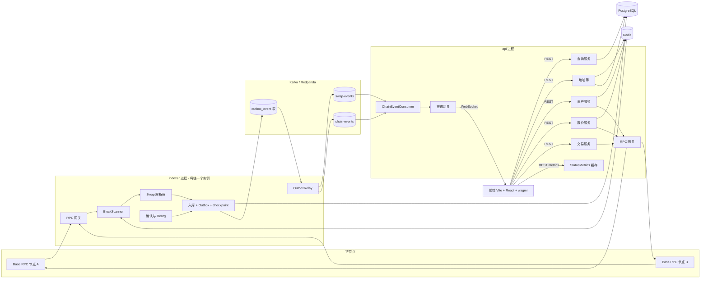
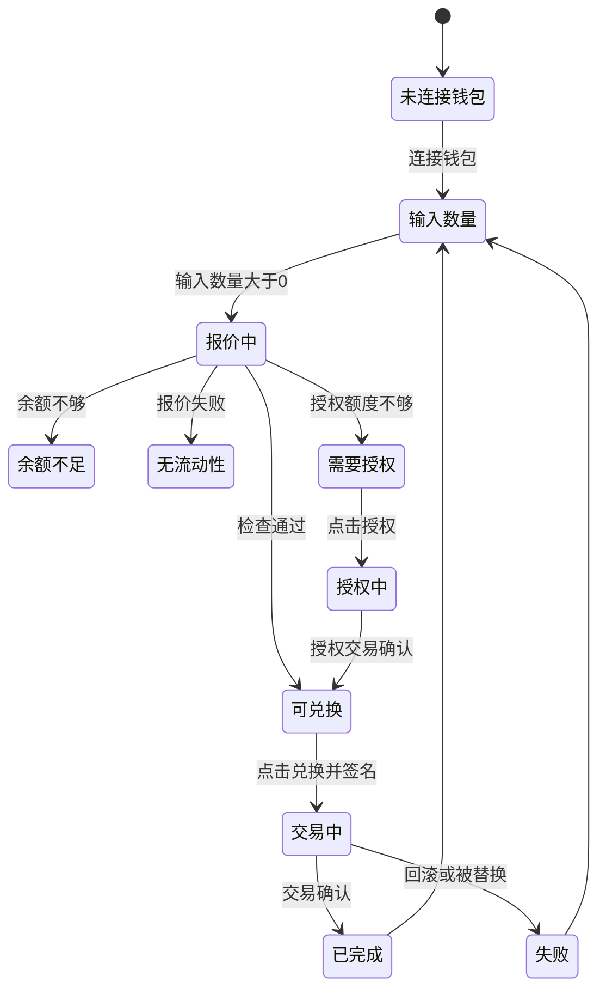
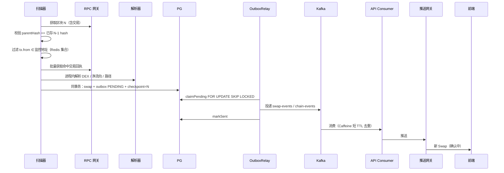
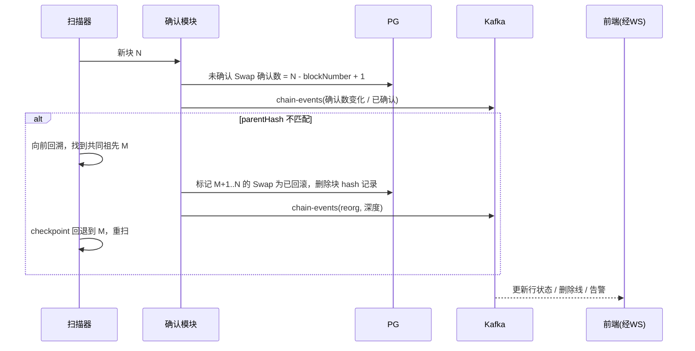
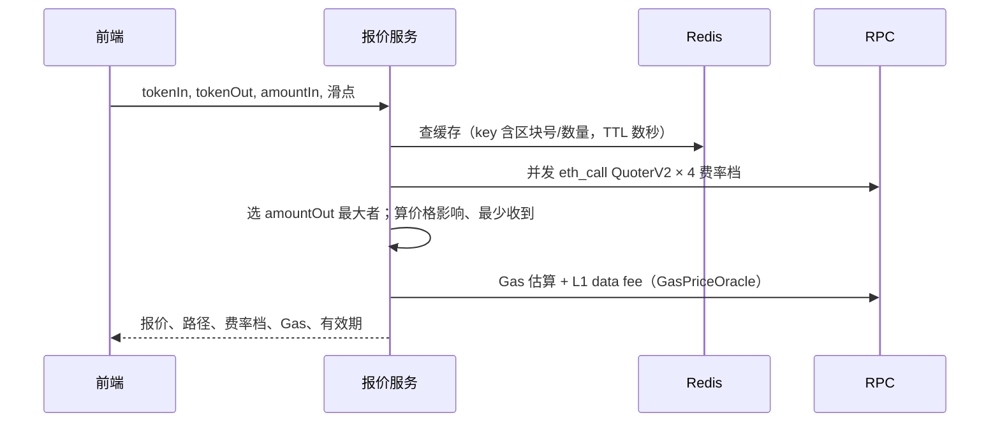
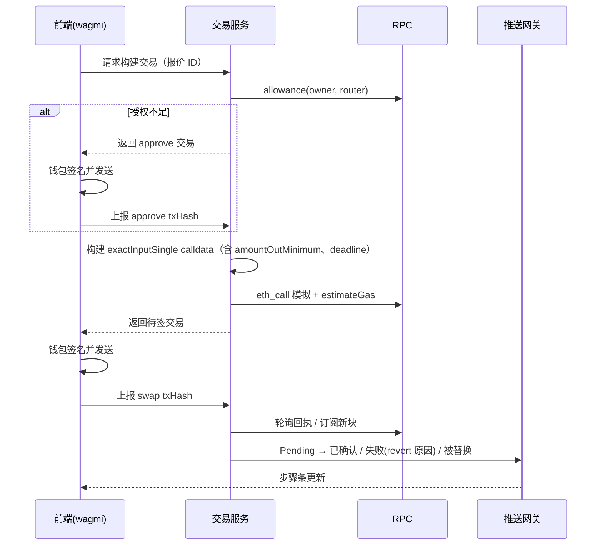
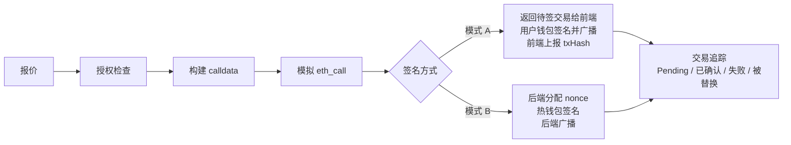
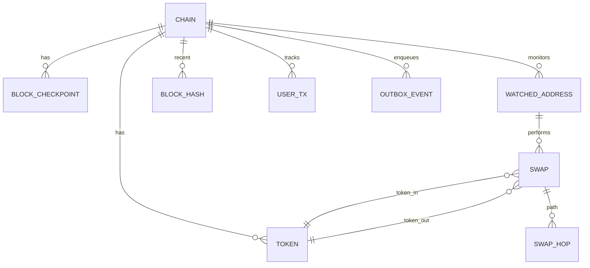

# Anchor 后端技术方案

> Base 链 DEX Swap 监控 + 兑换面板。实现以 `backend-java/` 为准；Kafka/WS 字段见 `contracts-shared/`。

## 1. 目标与范围

### 1.1 项目目标
- **监控**：对 Watchlist 中的地址，实时识别其在 Base 上的 DEX Swap（Uniswap V2/V3、Aerodrome、聚合器），推送到前端。
- **资产**：展示"我的钱包"的 ETH / ERC20 余额与净值。
- **兑换**：报价 → 授权 → 模拟 → 签名广播 → 状态追踪的完整交易链路。
- **可观测**：区块延迟、Kafka 积压、RPC QPS/错误率、Reorg 次数。

### 1.2 与 JD 的对应

| JD 要求 | 本项目体现 |
|---|---|
| 链上数据索引、交易状态跟踪 | 区块扫描器、确认与 Reorg 模块 |
| Swap / 报价 / 路由 / Gas | 报价服务、交易服务、L2 Gas 模型 |
| EVM Log 解析、Uniswap | Swap 解析器（V2/V3/Aerodrome/多跳/聚合器） |
| Java / Kafka / Redis / PG / 多模块 | 技术栈与进程拆分 |
| 地址画像 | 地址簿 + 统计 |
| Solana（加分） | 链适配层预留，后期实现 |

### 1.3 不做的事
- 不写自有 Swap 合约，直接调用 Uniswap 已部署合约。
- 不做 Mempool 监控（前端标题建议去掉 "Mempool"）。
- 主网不真实发交易，真实发送只在 Base Sepolia。

---

## 2. 整体架构



### 2.1 进程拆分

| 进程 | 职责 | 为什么独立 |
|---|---|---|
| **indexer** | 扫块、解析、入库、OutboxRelay、Reorg；`ScannerLease` 保证同链单活 | 有状态（checkpoint），需顺序推进 |
| **api** | REST + WebSocket，报价/资产/交易，消费 Kafka 推前端 | 面向用户，与扫块压力隔离 |

> 解析模块在代码上独立（`parser`），运行时合入 indexer 进程。`raw-blocks` 主题保留契约但不生产。

### 2.2 数据流与事件流
- **数据流（落库）**：RPC → BlockScanner → 解析 → **同一事务**写 PG（swap/hash）+ `outbox_event` + checkpoint。
- **事件流（推送）**：OutboxRelay → Kafka `swap-events` / `chain-events` → API `ChainEventConsumer`（短 TTL 去重）→ WS → 前端。
- **控制流（配置）**：地址簿变更 → Redis watch set → 扫描器按 `tx.from` 过滤。

---

## 3. 技术栈

| 组件 | 选型 | 理由 |
|---|---|---|
| 语言 | Java 21 | 当前实现栈；Spring Boot 3.3 多模块 |
| 链交互 | Web3j + 自研 `FailoverRpcGateway` | 多节点故障切换；合约调用与 Log 解析 |
| 消息队列 | Kafka（本地 Redpanda） | 分区有序；应用侧 Transactional Outbox |
| 缓存 | Redis | 地址集合、扫块租约、报价/余额短缓存、Token 元数据 |
| 数据库 | PostgreSQL + Flyway | 关系型；`outbox_event` jsonb；NUMERIC 存大数 |
| 持久层 | MyBatis-Plus + XML | 简单 CRUD 走 MP；多条件走 XML |
| 推送 | Spring WebSocket | 前端实时更新 |
| 指标 | Micrometer + Prometheus + Grafana | 状态栏读缓存；Grafana 看历史 |
| 部署 | `deploy/docker-compose.yml` | PG/Redis/Redpanda/监控 |
| 前端钱包 | wagmi + viem | Live 模式真实签名 |
| Solana（后期） | 适配层预留 | 见路线图 |

### 3.1 目录结构（实现）

```text
anchor/
├─ front_end/
├─ backend-java/
│  ├─ common/         # 实体、RPC、链配置、Mapper、DTO
│  ├─ indexer/        # BlockScanner、入库、OutboxRelay、Reorg
│  ├─ api/            # REST、WS、报价/交易、ChainEventConsumer
│  └─ parser/         # CompositeSwapParser 及各 DEX 实现
├─ db/migrations/     # Flyway（含 V5 outbox_event）
├─ contracts-shared/  # chains.yaml、Kafka/WS 契约
├─ deploy/
└─ docs/
```

---

## 4. 模块职责与边界

| # | 模块 | 职责 | 不负责 |
|---|---|---|---|
| 1 | **RPC 网关** | 多节点池、按节点限流、超时、重试、故障切换、QPS/错误率统计 | 业务逻辑 |
| 2 | **区块扫描器** | 按 checkpoint 顺序拉块；`max-catchup-blocks` 跳块；并发 getBlock；校验 parentHash；按监控地址过滤；**写入 outbox**（不直连 Kafka） | 解析 Swap |
| 3 | **Swap 解析器** | `DexParser` 接口；识别 DEX、方向、净输入/输出、多跳路径、聚合器；Token 元数据缓存 | 确认状态 |
| 4 | **确认与 Reorg** | 新块到来时更新确认数；≥ N 置为已确认；检测分叉，回滚受影响记录，从分叉点重扫 | 推送实现 |
| 5 | **地址簿** | 监控地址增删改、标签；统计 Swap 次数/最近活跃；同步地址集合到 Redis；可选回填最近 N 块 | 扫块 |
| 6 | **资产服务** | Multicall 批量查 ETH + ERC20 余额；基于池子价格算 USD 价值与净值；短缓存 | 交易 |
| 7 | **报价服务** | QuoterV2 对 4 个费率档并发 `eth_call`，选最优；价格影响；按滑点算最少收到；Gas 估算（含 L1 data fee） | 签名 |
| 8 | **交易服务** | 授权检查与 approve 构建；Swap calldata 构建；模拟；nonce 管理；广播；状态追踪（Pending/已确认/失败/被替换） | 私钥托管（模式 A） |
| 9 | **推送网关** | WebSocket 连接管理、订阅（按地址/交易哈希/指标）、心跳、断线补发 | 数据计算 |
| 10 | **运行指标** | 头块/已扫/落后、Kafka lag、`kafkaStale`、`outboxPending`、RPC QPS/错误率、Reorg；后台刷新缓存，REST/WS 只读 | — |
| 11 | **OutboxRelay** | 领取 PENDING（SKIP LOCKED）、投递 Kafka、失败退避；同批失败即停保序 | 业务入库 |

### 4.1 解析器关键规则
- **净流向以 ERC20 Transfer 为准**：V3 `Swap` 事件的 sender/recipient 通常是 Router，不是用户。以"监控地址作为 from 的 Transfer 总和"为付出、"to 为监控地址的 Transfer 总和"为收到；ETH 部分用 `tx.value` 和 WETH `Withdrawal` 事件补齐。
- **DEX 识别**：按 Pool 合约的 Swap 事件 topic + 工厂地址校验（防伪造池）。
- **多跳**：同一交易内多个 Swap 事件按顺序串成路径。
- **聚合器**：`tx.to` 命中已知 Router 表（1inch、0x、Odos、KyberSwap、Uniswap UniversalRouter）打标签。
- **方向规则**：付出计价币（ETH/WETH/USDC/USDbC）= BUY；收到计价币 = SELL；计价币互换 = SWAP。
- **幂等键**：`(chainId, txHash, logIndex)`。

### 4.2 确认策略（按链配置）

**背景**：一笔交易被打包进区块后，并不等于"板上钉钉"。链可能发生分叉（Reorg），最近几个块被替换，里面的交易就消失或变了。所以每条 Swap 都有一个"确认中 → 已确认"的过程。

判断"已确认"有两种方式：

| 方式 | 含义 | 优点 | 缺点 |
|---|---|---|---|
| **按块数** | 交易所在块之后又出了 N 个块，就认为安全 | 快（Base 上 10 块 ≈ 20 秒），前端能看到确认数 1/10、2/10… 跳动 | 理论上仍有极小概率被回滚 |
| **按最终确认标签** | 节点提供 `finalized` 标签，表示这个块已被 L1 以太坊最终确认，绝对不会再变 | 绝对安全 | 慢，Base 上大约 10–20 分钟 |

**方案决定：两级状态**
- `确认中 x/10` → **`已确认`**（达到 10 块，用于页面展示，体验好）
- → **`已最终确认`**（块号 ≤ `finalized` 块号，用于资产/对账等严肃场景，页面上用一个小图标标识）

| 链 | 出块 | 已确认（块数） | 已最终确认 |
|---|---|---|---|
| Ethereum 主网 | ~12s | 12 块 | `finalized` 标签，约 13 分钟 |
| Base | ~2s | 10 块 | `finalized` 标签，约 10–20 分钟 |
| Base Sepolia | ~2s | 5 块 | `finalized` 标签 |

---

## 5. 页面 ↔ 模块 ↔ 交互

原则：**用户主动请求的走 REST，后端产生的变化走 WebSocket**。前端除报价倒计时刷新外不轮询。

| 页面区域 | 后端模块 | 首屏加载 | 实时更新 |
|---|---|---|---|
| 顶部栏：链选择、连接钱包 | 链注册表 | REST 获取支持链列表 | — |
| Watchlist | 地址簿 | REST 列表；增删改 | WS 推送"最近活跃"变化 |
| RECENT SWAPS | 查询服务、解析器、确认模块 | REST 分页（按地址/DEX/方向筛选） | WS：新 Swap、确认数+1、已确认、已回滚 |
| 我的钱包 | 资产服务 | REST 余额与净值 | 本人交易确认后 WS 通知刷新 |
| SWAP 兑换面板 | 报价、交易服务 | 输入数量后 REST 报价（防抖 300–500ms） | 报价每 10–15s 倒计时刷新 |
| 步骤条（授权→兑换→确认） | 交易服务 | REST 构建/提交 | WS：Pending → 已确认/失败/被替换 |
| 状态栏 | 运行指标 | REST 首次 | WS 每 2–5s 推送 |

### 5.1 主按钮状态机（前后端共同决定）



---

## 6. 关键流程

### 6.1 Swap 入库


> checkpoint 与 outbox **同事务提交**；Kafka 由 OutboxRelay 异步至少一次投递。Kafka 故障不阻塞扫块，积压看 `outboxPending`。

### 6.2 确认与 Reorg


### 6.3 报价


### 6.4 授权 + 兑换 + 追踪（模式 A：用户钱包签名）

实现侧概念梳理与 FAQ（两套 Swap、quoteId、allowance、prepare、eth_call 模拟等）见 `docs/swap-trade-flow.md`。



### 6.5 钱包模式对比

| | 模式 A：用户签名（主流程） | 模式 B：后端热钱包（仅测试网） |
|---|---|---|
| 私钥位置 | 用户浏览器钱包 | 后端（环境变量/KMS） |
| 广播方 | 钱包 | 后端 |
| nonce | 钱包管理 | 后端管理（Redis 分布式锁 + 本地递增 + 链上校准） |
| 展示的能力 | 前后端协作、交易构建与追踪 | 并发 nonce、卡单加速（同 nonce 提高 gas 替换）、取消 |
| 使用链 | 主网可报价 / 测试网发送 | 仅 Base Sepolia |

### 6.6 两种模式如何切换

**可以做，而且两种模式能共用大部分代码。** 两者唯一的区别是"谁来签名、谁来广播"，前面的报价、授权检查、calldata 构建、模拟，以及后面的状态追踪完全一样。



**设计要点**
- 交易服务内部定义一个**签名器接口**（Signer），两种实现：
  - `ClientSigner`（模式 A）：不签名，只把交易返回给前端，等待前端上报 txHash。
  - `HotWalletSigner`（模式 B）：后端用私钥签名并广播，附带 nonce 管理器。
- **切换粒度**：按"链 + 请求"决定。
  - 链注册表中每条链配置允许的模式，例如主网只允许 A，Base Sepolia 允许 A 和 B。
  - 前端兑换面板加一个开关"使用钱包签名 / 使用后端测试钱包"，请求里带上 mode。
  - 后端校验 mode 是否被该链允许，不允许则拒绝（防止误在主网用热钱包）。
- **"我的钱包"区域**：模式 A 显示用户连接的钱包地址和余额；模式 B 显示后端热钱包地址和余额。两者都走同一个资产服务，只是查询的地址不同。
- **模式 B 独有的功能**（页面上可在交易进行中显示）：
  - 加速：同一 nonce 提高 gas 重新发送。
  - 取消：同一 nonce 给自己转 0 ETH。
  - 并发：连续点击多次兑换，展示 nonce 依次递增、互不冲突。

---

## 7. 多链设计

### 7.1 链注册表（配置驱动）
每条链一份配置，新增 EVM 链只改配置不改代码：
- chainId、名称、链类型（EVM / Solana）、是否测试网
- RPC 节点列表及各自限速
- 关键合约地址：WETH、USDC、Uniswap Factory/Router/QuoterV2、Aerodrome Router、Multicall3
- 支持的 DEX 列表、已知聚合器 Router 列表
- 计价币列表（用于方向判断）
- 确认策略：阈值块数 / 使用 finalized 标签
- Gas 模型：`eip1559` 或 `eip1559 + op-l1-fee`

### 7.2 EVM 主网 vs L2 差异

| 维度 | Ethereum 主网 | Base（OP Stack） |
|---|---|---|
| 出块 | ~12s | ~2s，扫描频率更高，需批量拉取 |
| Gas | EIP-1559 | EIP-1559 + **L1 data fee**（GasPriceOracle `getL1Fee`） |
| Reorg | 偶发 1–2 块 | sequencer 后极少，L1 回滚时才可能 |
| 主要 DEX | Uniswap | Aerodrome（最大）、Uniswap |

### 7.3 Solana 适配策略
**共享平台 + 链适配器**，不另起项目，也不强行抽象底层原语。

| 共享 | 每链独立实现 |
|---|---|
| 业务模型：Swap 记录、报价、交易状态、地址簿 | 数据获取：EVM 扫块 vs Yellowstone gRPC 订阅 |
| Kafka / PG / Redis / WS / 指标 | 解析：EVM Log vs `pre/postTokenBalances` + 指令解析 |
| 前端页面与交互 | 报价/交易：Uniswap 合约 vs Jupiter API |
| | 钱包：wagmi vs Phantom wallet-adapter |
| | 状态：确认数 vs processed/confirmed/finalized |
| | 交易：nonce vs recent blockhash；无 approve；Compute Unit + 优先费 |

抽象边界放在**业务接口层**：`ChainScanner`、`SwapParser`、`Quoter`、`TxBuilder`、`TxTracker`。

> **实施说明：Solana 写入方案，第一版不实现。** 第一版只做 EVM，但要提前满足以下约束，保证以后加 Solana 时不用推翻重来：
> 1. 链注册表中保留"链类型"字段，所有业务表都带链标识。
> 2. 地址、交易哈希字段按字符串存储，不假设是 0x 开头的 20/32 字节（Solana 是 Base58）。
> 3. 确认状态用通用的"确认中 / 已确认 / 已最终确认 / 已回滚"，不在业务层写死"确认块数"。
> 4. 扫描器、解析器、报价、交易都通过上面的接口调用，业务代码不直接依赖 go-ethereum 类型。
> 5. 授权步骤作为"可选步骤"，Solana 上直接跳过。

---

## 8. 数据模型（实体级）



| 实体 | 说明 |
|---|---|
| 链 | 来自注册表，库中做引用 |
| 区块 checkpoint | 每链已处理到的块号 |
| 近期区块 hash | 最近 N 块的 hash，用于 Reorg 检测 |
| Token | 地址、symbol、decimals，懒加载 + 缓存 |
| 监控地址 | 地址、标签、统计 |
| Swap | 一次 Swap：交易、DEX、方向、净输入/输出、确认状态 |
| Swap 路径 | 多跳的每一跳 |
| Outbox 事件 | `PENDING`/`SENT`；topic、msg_key、payload、attempts、next_attempt_at |
| 用户交易 | 兑换面板发起的 approve / swap 交易及状态 |

金额统一按最小单位存 `NUMERIC(78,0)`，展示时再按 decimals 换算。

---

## 9. 可靠性与安全

### 9.1 可靠性
| 风险 | 措施 |
|---|---|
| 进程重启丢进度 | checkpoint 持久化，重启从 checkpoint+1 继续 |
| 重复入库 | 幂等键 Upsert `(chainId, txHash, logIndex)` |
| 重复推送 | Outbox 至少一次 + API Caffeine 短 TTL 去重 |
| Kafka 故障 | 扫块只写 outbox；Relay 退避重试；同批失败 break 保序 |
| 多 Indexer | `ScannerLease` 单活扫块；Relay `SKIP LOCKED` 分片领取 |
| RPC 限流/故障 | 退避重试、多节点切换 |
| 扫描落后 | `max-catchup-blocks` 跳到近头；`catchup-batch-size` 并发 getBlock |
| Reorg | parentHash 校验 + 回溯 + 回滚标记 + 重扫（事件同样走 outbox） |
| WS 断线 | 序号补发；过期则 `RESYNC` + REST 重拉 |
| 新增监控地址 | 可选回填最近 N 块 |

### 9.2 安全
- 必须设置 `amountOutMinimum` 和 `deadline`，防三明治攻击与过期执行。
- 发送前必须 `eth_call` 模拟，失败则不让签名并展示 revert 原因。
- approve 默认按需授权（精确数量），无限授权需用户勾选。
- 模式 B 私钥只存环境变量或 KMS，不入库、不进日志，仅限测试网。
- 报价接口限流，防止被刷 RPC 额度。
- 合约地址只从注册表读取，不接受前端传入 Router 地址。

---

## 10. 可观测性

| 指标 | 用途 | 展示位置 |
|---|---|---|
| headBlock / processedBlock / lagBlocks | 扫描健康度 | 状态栏 + REST metrics |
| kafkaLag / kafkaStale | 消费积压与 Admin 可用性 | 状态栏 |
| outboxPending | 待推送事件积压 | 状态栏 |
| RPC QPS、错误率 | 节点质量（后台缓存，防采样互相干扰） | 状态栏 + Grafana |
| Reorg 次数、最大深度 | 链稳定性 | 状态栏 |
| 扫块/解析/Outbox/Kafka DLT 等 | 工程质量 | Prometheus / Grafana |

日志带 chainId、blockNumber、txHash；状态栏数据由 `StatusMetricsService` 定时刷新缓存，请求线程不直打 RPC/Kafka Admin。

---

## 11. 分阶段路线

| 阶段 | 内容 | 交付物 | 页面可见效果 |
|---|---|---|---|
| **P0** ✅ | 工程骨架 | docker-compose、配置、日志 | — |
| **P1** ✅ | RPC 网关、扫描器 + checkpoint、解析、地址簿、Swap 查询 | indexer + api | Watchlist / RECENT SWAPS 真实数据 |
| **P2** ✅ | 确认与 Reorg、Outbox→Kafka、WebSocket | 事件流打通 | 实时 Swap、确认跳动、reorg |
| **P3** ✅ | V2 / Aerodrome / 多跳 / 聚合器 | 多个 Parser | DEX、路径、聚合器标签 |
| **P4** ✅（主路径） | 钱包、资产、报价 | wagmi + Quote API | 余额与报价 |
| **P5a** ✅ | 模式 A 用户钱包签名（Sepolia） | prepare / report | 步骤条真实流程 |
| **P5b** | 模式 B 热钱包 | 待做 | — |
| **P6** ✅（主路径） | 指标缓存 + Grafana 基建 | StatusMetrics + Prometheus | 状态栏真实指标 |
| **P7** | Solana 等 | 见 `roadmap-tasks.md` | — |

建议每个阶段结束写一篇技术总结（遇到的坑、取舍），作为面试素材。

---

## 12. 风险与待定问题

| 问题 | 影响 | 应对 |
|---|---|---|
| 公共 RPC `mainnet.base.org` 限流严格 | 扫块跟不上、报价失败 | 申请 Alchemy/QuickNode/Infura 免费额度做多节点 |
| Base Sepolia 流动性稀薄 | 测试网兑换失败或滑点极大 | 自己部署测试 Token 并建 V3 池 |
| Aerodrome ABI 与 Uniswap 不同（V2 风格 + Slipstream CL 池） | 解析遗漏 | 单独实现两个 Parser |
| 只按 `tx.from` 过滤会漏掉合约钱包/AA（ERC-4337）发起的 Swap | 数据不全 | 后期改为按 Transfer 日志的 from/to 匹配 |
| 价格来源单一（池子价格） | 小币价格失真 | 只对有足够流动性的池计价，否则显示 "—" |
| 国内访问 Google Fonts / Unsplash 超时 | 前端加载慢 | 前端字体与图片本地化 |

### 已决策
1. 确认策略：两级状态，10 块为"已确认"，`finalized` 为"已最终确认"（见 4.2）。
2. 钱包模式：A、B 都做，通过签名器接口按链 + 请求切换；主网只允许 A（见 6.6）。
3. Solana：写入方案并预留扩展约束，第一版不实现（见 7.3）。
