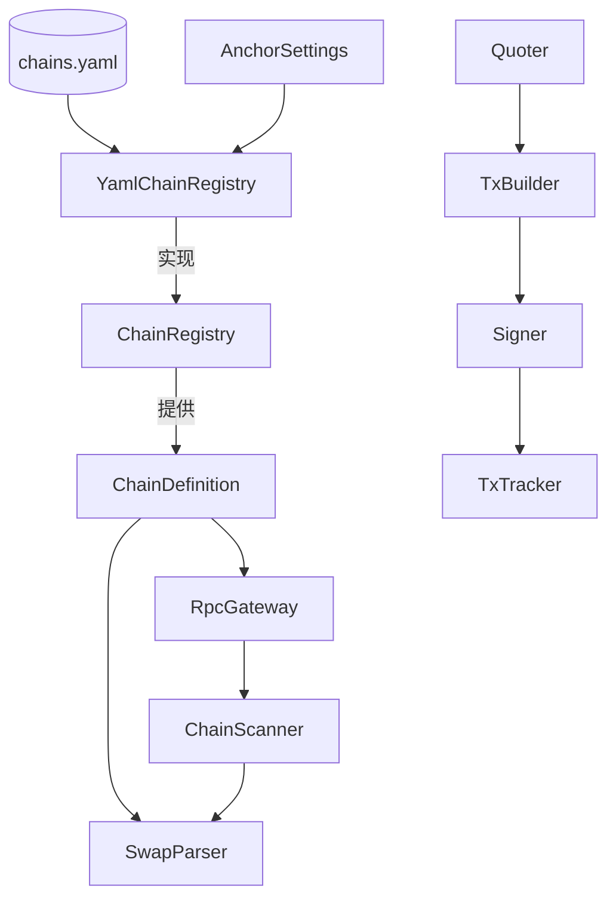
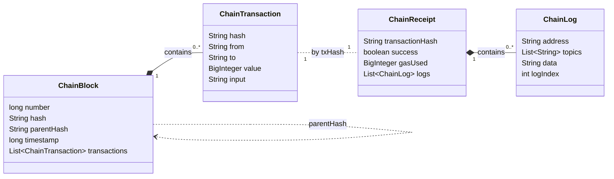
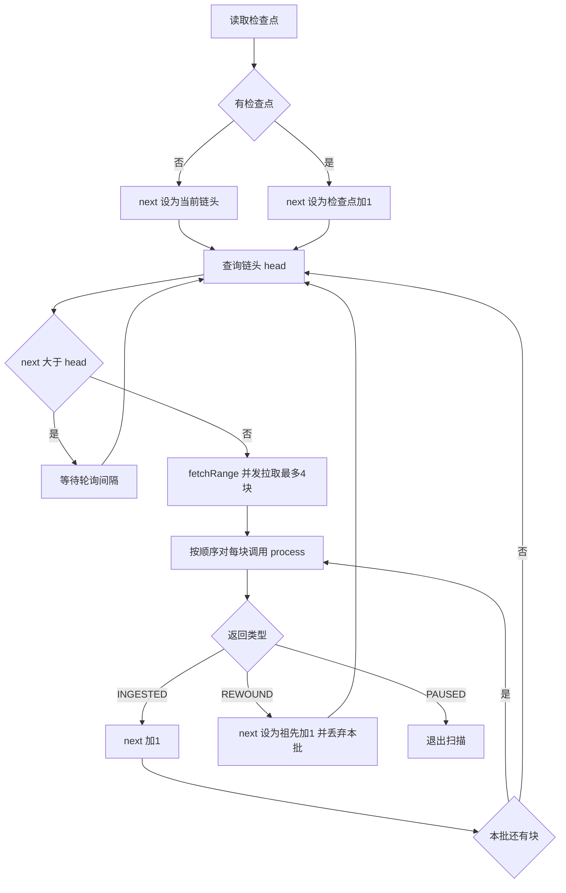
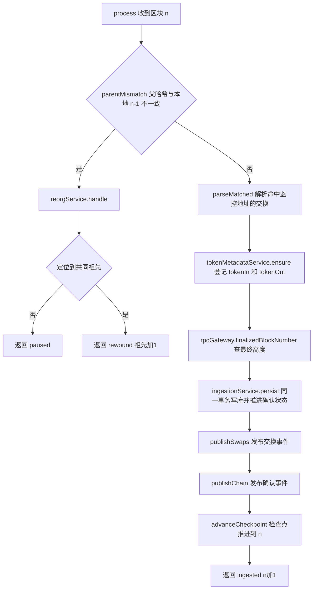
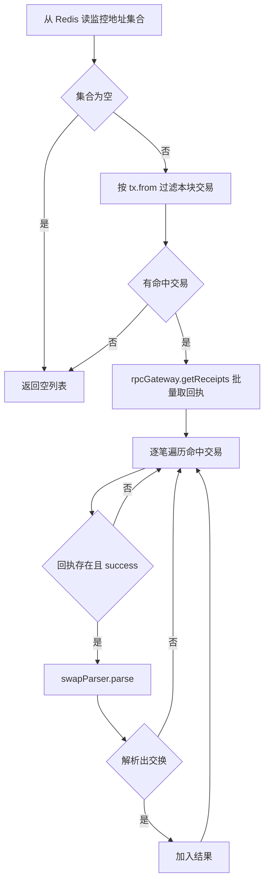
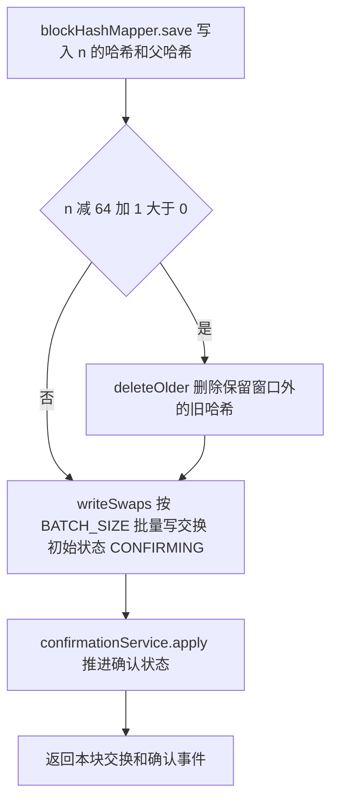
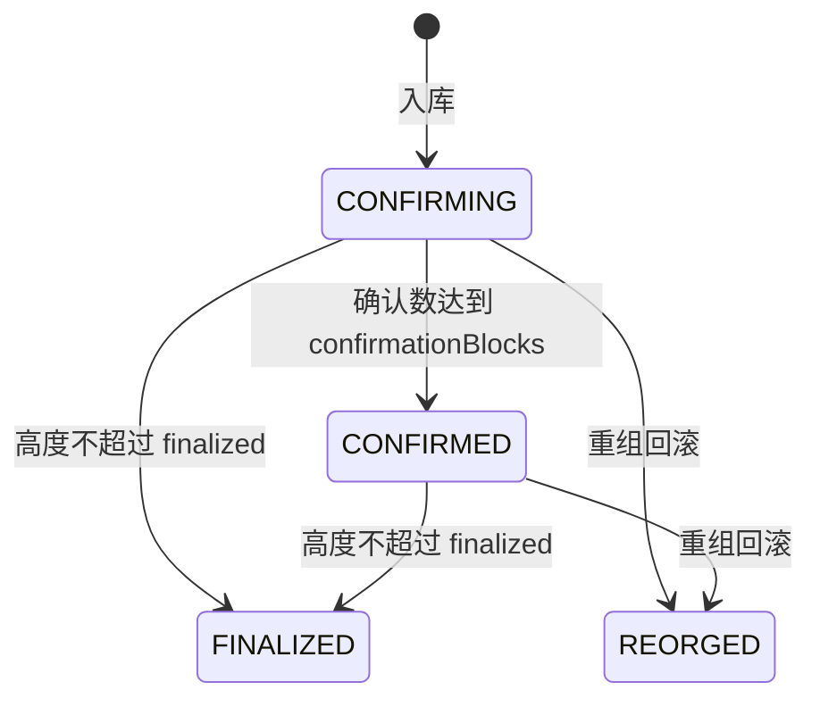
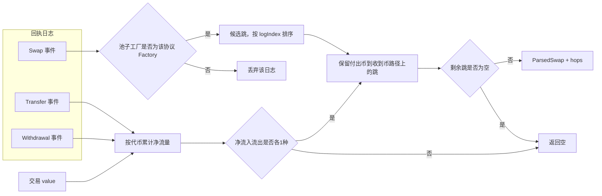

# `com.anchor.common.chain` 说明

本文整理链上数据模型和扫描、解析流程，回答「区块、交易、回执、日志」之间的关系。

## 1. 包内类型怎么分组

| 分组 | 类型 | 作用 |
|---|---|---|
| 配置 | `ChainDefinition`、`ChainRegistry`、`YamlChainRegistry`、`AnchorSettings` | 来自 `chains.yaml`，描述这条链怎么配置 |
| 链上数据 | `ChainBlock`、`ChainTransaction`、`ChainReceipt`、`ChainLog` | 从 RPC 读回来的区块与执行结果 |
| 读取与解析 | `RpcGateway`、`ChainScanner`、`SwapParser` | 扫块、拉回执、解析交换 |
| 交易路径占位 | `Quoter`、`TxBuilder`、`Signer`、`TxTracker` | 只有接口，尚未实现 |

`ChainDefinition` 和另外四个 record 性质不一样：前者是「这条链怎么配」，后者是「链上实际发生了什么」。

实现位置：

| 接口 | 实现 |
|---|---|
| `ChainRegistry` | `chain.YamlChainRegistry` |
| `RpcGateway` | `common.manager.FailoverRpcGateway`（限流、重试、节点切换） |
| `ChainScanner` | `indexer.scan.BlockScanner` |
| `SwapParser` | `parser.swap.CompositeSwapParser`（汇总 `parser.swap.hop` 下各协议的 `DexHopParser`） |



## 2. 数据模型：区块、交易、回执、日志

一个区块里有多笔交易，但区块里**没有日志**。日志只在交易执行完后的回执里，必须用交易哈希另外去取。



| 概念 | 是什么 | 在本项目里的用途 |
|---|---|---|
| `ChainBlock` | 某个高度上的一个区块 | `number` 推进检查点；`hash` / `parentHash` 发现重组；`timestamp` 作为交换时间 |
| `ChainTransaction` | 用户发起的一笔交易（意图） | `from` 匹配监控地址；`to` 通常是 Router；`value` 是随交易付出的 ETH |
| `ChainReceipt` | 交易执行后的结果 | `success=false` 直接跳过 |
| `ChainLog` | 合约执行时发出的事件 | `topics[0]` 区分 Swap / Transfer / Withdrawal；`address` 是发出事件的合约 |

一句话：交易是用户的意图，回执和日志是执行结果。交换的方向和金额都从日志里算，不看交易的 `input`。

### 2.1 `ChainBlock` 和 `ChainReceipt` 有没有包含关系？

**没有。** `ChainReceipt` 不在 `ChainBlock` 里面。

```text
ChainBlock
  └── transactions: List<ChainTransaction>   ← 区块里只有交易

ChainTransaction.hash
        │
        │  用 hash 再调一次 RPC
        ▼
ChainReceipt.transactionHash
  └── logs: List<ChainLog>                   ← 日志在回执里
```

| | `ChainBlock` | `ChainReceipt` |
|---|---|---|
| 怎么取 | `getBlock(chainId, number)` | `getReceipts(chainId, txHashes)` |
| 里面有什么 | 高度、哈希、父哈希、时间、交易列表 | 是否成功、gas、日志 |
| 对应链上概念 | 区块体 | 交易执行结果 |

链上时间顺序是：交易先被放进区块，区块执行完才产生回执。所以回执是**执行之后**才有的结果，不是区块结构的一部分。代码里两者的关联键只有 `transactionHash`。

### 2.2 回执在链上吗？为什么又不在区块里？

**在链上，但不在区块体里。**

- **在链上**：回执是共识执行的结果。区块头里有 `receiptsRoot`，把本块所有回执的默克尔根写进去了，内容确定、可验证，节点也会持久化保存。
- **不在区块体里**：区块体里装的是交易列表。回执本身不嵌在区块结构里，要用交易哈希另外查（本项目就是 `RpcGateway.getReceipts`）。

简单说：交易在区块里；回执在链上、跟这笔交易绑定，但是单独存、单独查。

本项目故意拆开，是为了少打 RPC：

1. 先拿 `ChainBlock`，用 `tx.from` 筛监控地址  
2. 只有命中的交易，才按 hash 去取 `ChainReceipt`  
3. 再用回执里的 `logs` 解析交换  

## 3. 整体流程：从扫块到入库

扫描由 `indexer.scan.BlockScanner` 完成，分两层：

- `scanForever`：外层循环，决定下一块从哪开始、一次拉几块。
- `process`：处理单个区块，返回一个 `ScanStepDTO` 告诉外层接下来怎么走。

`process` 有三种返回值：

| 返回值 | 什么时候 | 外层怎么处理 |
|---|---|---|
| `ingested(n+1)` | 本块正常入库 | `next = n+1`，继续处理本批下一块 |
| `rewound(祖先+1)` | 发生重组且定位成功 | `next = 祖先+1`，丢弃本批剩余块，重新拉块 |
| `paused()` | 发生重组但定位失败 | 退出 `scanForever`，等待人工处理 |

### 3.1 `scanForever` 外层循环



- 没有检查点时直接从链头开始，**不回补历史块**。
- 拉块是并发的（虚拟线程，最多 `CATCH_UP_CONCURRENCY` 块），但 `process` 严格按高度顺序执行。
- 任何 `RuntimeException`（RPC 失败、Kafka 发送失败等）都会被外层捕获，等待后用**同一个 next** 重试。因为检查点没推进，所以同一块会被重新处理。

### 3.2 `process` 主流程



顺序上的约束：

- **先发布、后推进检查点**。Kafka 发送失败会抛异常，检查点停在 n-1，下次重扫 n，保证下游至少收到一次。代价是下游可能收到重复事件，需要按 `txHash + logIndex` 去重。
- **本地没有 n-1 的哈希时不算不一致**（例如第一次启动从链头开始），直接按正常块处理。
- 重组分支的详细过程见 [reorg-locate-walkthrough.html](./reorg-locate-walkthrough.html)，这里不展开。

### 3.3 `parseMatched`：只给命中的交易取回执



两处为了省 RPC：

- 先用区块里的交易做筛选，只有 `from` 是监控地址的交易才去请求回执。
- 只保留最近 64 个区块哈希，这已经够判断父哈希是否断了。

### 3.4 `persist` 与确认状态

`BlockIngestionServiceImpl.persist` 在一个事务里（`rollbackFor = Exception.class`）完成：



`ConfirmationServiceImpl.apply` 取出本链 `block_number <= head` 且状态为 `CONFIRMING` / `CONFIRMED` 的交换，逐条计算新状态：



- 确认数 = `head - blockNumber + 1`，`confirmationBlocks` 来自 `chains.yaml`。
- 状态变化时写库。事件方面：之前块的记录每来一个新块都会发一条（带最新确认数），本块刚入库的记录只在状态变化时发；事件由 `process` 通过 `publishChain` 发出。
- `REORGED` 由 `ReorgManager.apply` 设置，不在 `ConfirmationService` 里处理。

## 4. 单笔交易怎么解析成一笔交换

`CompositeSwapParser` 只读回执里的日志。各协议的跳解析器先找出经工厂校验的 Swap，再用净流量确定用户实际付出和收到的币，最后只保留两者之间路径上的跳：

| 跳解析器（`parser.swap.hop`） | Swap 事件 | 校验工厂（`chains.yaml`） |
|---|---|---|
| `UniswapV3HopParser` | V3 `Swap(int256,int256,…)` | `uniswapV3Factory` |
| `UniswapV2HopParser` | V2 `Swap(uint256×4)` | `uniswapV2Factory` |
| `AerodromeHopParser` | Aerodrome 经典池 `Swap(sender,to,uint256×4)` | `aerodromeFactory` |
| `AerodromeSlipstreamHopParser` | 与 V3 同签名 | `aerodromeSlipstreamFactory` |



- **路径**：一跳被保留，当且仅当它的付出币能从用户付出币经若干跳到达，且它的收到币能继续到达用户收到币。串行多跳和聚合器拆单都会保留，同交易里无关的 Swap 被剔除。原生币按 WETH 匹配。
- **dex**：全部跳同一协议时为该协议名，否则为 `Multi`。`logIndex` 取首跳。
- **aggregator**：`tx.to` 命中 `chains.yaml` 的 `aggregators` 时写入名称。
- **Transfer**：监控地址转出记为负，转入记为正。只计 3 个 topic 的 ERC20 Transfer。
- **Withdrawal**：WETH 拆成 ETH，`src` 是用户或 Router 时，都记成用户收到了原生 ETH，地址用 `0xeeee…`。
- **value**：交易随附的 ETH 记成付出。
- **方向**：用 `quoteTokens` 判断。付出报价币、收到其他币是买入；反过来是卖出；两边都是或都不是报价币就是兑换。

规则摘要：只保留工厂校验通过、净输入和净输出都恰好一种币、且至少有一跳连通两者的交换。
