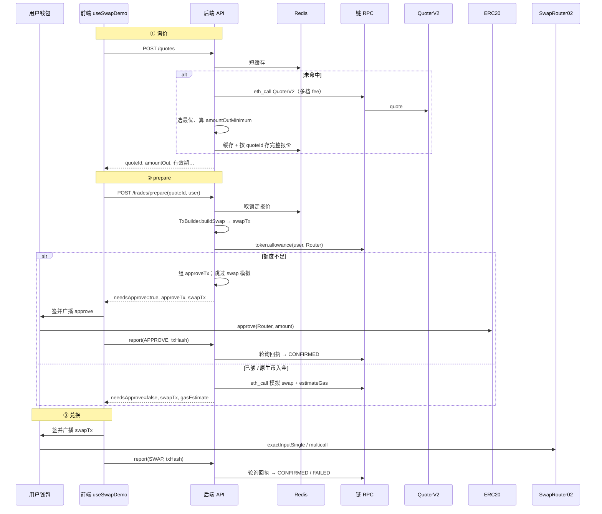

# 询价与兑换流程说明（P5a 模式 A）

本文整理 Swap 兑换相关概念与端到端流程，对应当前实现（自有前端 + 自有后端 + 链上 Uniswap 合约）。设计原文见 `backend-design.md` 第 6.3–6.6 节；联调步骤见 `p5a-sepolia-checklist.md`。

---

## 1. 先分清两套「Swap」

| | A. 监控里的 Swap（Indexer） | B. 兑换面板里的 Swap（Trade / P5a） |
|---|---|---|
| 是什么 | 扫块解析出的 DEX 交换事件 | 用户在页面上主动询价并兑换 |
| 入口 | Indexer → Parser → 表 `swap` / Kafka | `quotes` → `prepare` → 钱包签名 → `report` |
| 页面表现 | RECENT SWAPS、确认进度 | 步骤条：授权 → 兑换 → 确认 |
| 本文范围 | 仅作对照 | **主体** |

兑换成功且地址在 watchlist 时，Indexer 可能再解析出一条监控记录，那是**另一条异步链路**，不参与询价 / prepare。

---

## 2. 架构：我们调的是谁？

**不是**请求 Uniswap 官网 / 云端 HTTP API。页面与业务 API 都是我们的；成交与报价走**链上已部署的 Uniswap 合约**，经公共 RPC 节点访问。

```text
[浏览器 Swap 页面 / useSwapDemo]
        │  HTTP：/api/v1/quotes、/trades/prepare、/trades/report
        ▼
[我们的后端 API]
  · QuoteQueryServiceImpl（报价服务）
  · TradeQueryServiceImpl（交易服务）
        │  JSON-RPC：eth_call / estimateGas / getReceipts
        ▼
[链节点 RPC]（chains.yaml 中的 url，如 Alchemy）
        │
        ▼
[链上合约]
  · QuoterV2     ← 只读询价
  · SwapRouter02 ← 真正兑换
  · ERC20        ← allowance / approve
```

| 角色 | 是什么 | 做什么 |
|---|---|---|
| `useSwapDemo` | 前端 hook | 询价、点兑换、调 prepare/report、唤起钱包、步骤条 |
| 报价服务 | 后端 `@Service` | 调 QuoterV2、缓存、签发 `quoteId` |
| 交易服务 | 后端 `@Service` | prepare / report / 查状态 / 轮询回执 |
| 链 RPC | 区块链节点入口 | 读合约、估 gas、查回执；**不是** Uni 公司服务器 |
| QuoterV2 | 链上合约 | 只读「能换多少」 |
| SwapRouter02 | 链上合约 | 执行兑换的「前台」 |

---

## 3. 关键概念

### 3.1 SwapRouter（SwapRouter02）

Uniswap 部署在链上的**兑换入口合约**。用户不直接跟每个池子交互，而是把「用 A 换 B、数量、最少收到多少、收款人」发给 Router，由它去调池子。

地址配置在 `chains.yaml` 的 `swapRouter02`。本项目用 `SwapRouterTxBuilder` 组 `exactInputSingle`，再包进 `multicall(deadline, …)`。

### 3.2 allowance（授权额度）

不是「钱包授权给某个 token」，而是：

> **你（owner）授权给某个 spender（这里是 SwapRouter02），允许它从你钱包花某个 ERC20 最多多少。**

| 角色 | 是谁 |
|---|---|
| token 合约 | 例如 USDC |
| owner | 用户钱包 |
| spender | SwapRouter02 |
| allowance | Router 还能从该用户扣多少该 token |

要点：

- 额度是**剩余可用**：approve 100、swap 花 30，还剩 70，**后续还能用**，不必每次都 approve。
- `infiniteApprove` 会批极大值，同一 Router 往往长期不用再授权。
- 只批「本次数量」时，下次不够还要再 approve。
- **原生 ETH 入金没有 allowance**，不走 ERC20 approve。
- 钱包不会在点 Swap 时自动产生额度；链上没批过或不够，就必须先发 **approve** 交易（与 Uni 官网「先 Approve 再 Swap」同类）。

### 3.3 prepare

`POST /api/v1/trades/prepare`：在用户签名**之前**，后端根据锁定报价组好待签交易，并检查是否要先授权、是否做模拟。

- **不广播、不扣币**
- 返回：`needsApprove`、`approveTx`（可选）、`swapTx`、`gasEstimate`、`deadline` 等

### 3.4 eth_call「模拟」

`prepare` 在授权足够时会对 `swapTx` 调用：

```text
rpcGateway.ethCall(chainId, user, swapTx.to(), swapTx.data(), value)
```

这是 JSON-RPC **请求节点**，但方法是 **`eth_call`**：节点本地假装执行，**不上链、不改状态、不花 gas**。用于提前发现必失败的交易（返回 `SIMULATION_FAILED`）。

| 方法 | 含义 | 改链上状态 | 花 gas |
|---|---|---|---|
| `eth_call` | 本地试执行 | 否 | 否 |
| `eth_estimateGas` | 估算 gas | 否 | 否 |
| 钱包 `sendTransaction` / `eth_sendRawTransaction` | 真正广播 | 是（上链后） | 是 |

### 3.5 为什么要把每次报价存起来（quoteId）

**主要不是为了锁 gas。** 目的是：

1. **锁定成交条件**：token、数量、fee、`amountOutMinimum` 等  
2. **防篡改**：`prepare` 只认服务端 Redis 里的报价，前端改不了金额 / router  
3. **短缓存**：相同参数少打几次 Quoter  

与波动的关系：

| 波动 | 存报价能否兜住 |
|---|---|
| 币价 / 池子变差 | 靠 `amountOutMinimum`：太差则 swap **revert** |
| gas 费暴涨 | **未锁死 gas 单价**；钱包广播时自带 `maxFeePerGas` 等，可能更贵、用户取消、或 fee 过低一直 pending |

---

## 4. 端到端流程



### 分步说明

1. **询价** `POST /api/v1/quotes`  
   前端防抖调用；后端 `UniswapV3Quoter` 对 QuoterV2 并发多档 fee 的 `eth_call`，选 `amountOut` 最大者，写入 `quoteId`。

2. **prepare** `POST /api/v1/trades/prepare`  
   - `TxBuilder.buildSwap`：把报价编成 Router 可执行的 calldata（未签名）  
   - 查 `allowance`  
   - 不够：`needsApprove=true` + `approveTx`，**跳过** swap 模拟（否则必然 revert，误报失败）  
   - 够了：对 `swapTx` 做 `eth_call` + `estimateGas`

3. **授权（仅 needsApprove）**  
   钱包签 `approveTx` → `report(APPROVE)` → 后端轮询至 CONFIRMED。

4. **兑换**  
   钱包签 `swapTx` → `report(SWAP)` → 轮询回执；Router 用 allowance 扣 ERC20（或用 `value` 收 ETH），输出不少于 `amountOutMinimum`。

5. **判断是否要授权**  
   以 **`needsApprove`** 为准；为 true 时通常同时返回非空 `approveTx`。前端：`if (needsApprove && approveTx) { … }`。

---

## 5. `TxBuilder.buildSwap` 做什么

实现类：`SwapRouterTxBuilder`。

1. 用 `StoredQuote` 的 tokenIn/Out、fee、`amountIn`、`amountOutMinimum`  
2. 编码 `exactInputSingle`  
3. 包进 `multicall(deadline, [inner])`  
4. 返回 `UnsignedTransaction`：`to` = SwapRouter02，`data` = calldata，原生币入金时 `value = amountIn`  

**只组交易，不签名、不广播。** `buildApprove` 则组 `token.approve(Router, amount)`。

---

## 6. 与 Uniswap 网页的对应

| Uniswap 网页 | 本系统 |
|---|---|
| 输入数量看出价 | `/api/v1/quotes` → QuoterV2 |
| 第一次要 Approve | prepare → `needsApprove` + `approveTx` |
| 再点 Swap | 钱包签 `swapTx` |
| 等上链 | `report` + 回执轮询 / WS `TX_UPDATE` |

区别：组交易、滑点下限、报价锁定在**我们服务端**；钱包只负责签名广播（模式 A）。

---

## 7. 代码入口（便于对照）

| 环节 | 位置 |
|---|---|
| 前端询价 / 兑换 | `front_end/src/hooks/useSwapDemo.ts` |
| 前端 API 封装 | `front_end/src/api/anchor.ts` |
| 报价 API | `QuoteController` → `QuoteQueryServiceImpl` → `UniswapV3Quoter` |
| 交易 API | `TradeController` → `TradeQueryServiceImpl` |
| 组 approve / swap | `SwapRouterTxBuilder` |
| 合约地址 | `contracts-shared/chains.yaml`（`quoterV2`、`swapRouter02`） |

---

## 8. 已知注意点

- **授权后再次 prepare**：`useSwapDemo` 在 approve CONFIRMED 后会再调一次 `prepare`，用第二次返回的 `swapTx`（含模拟与 gasEstimate）再签名广播。  
- **交易链限制**：P5a 准备/上报目前仅允许 Base Sepolia（`TRADE_ALLOWED_CHAIN_ID = 84532`）。  
- **模式 B**（热钱包签名广播）见 `backend-design.md` 6.5–6.6，本文不展开。
